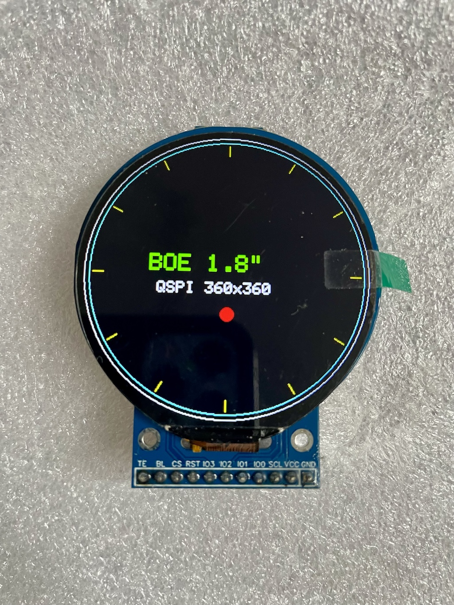
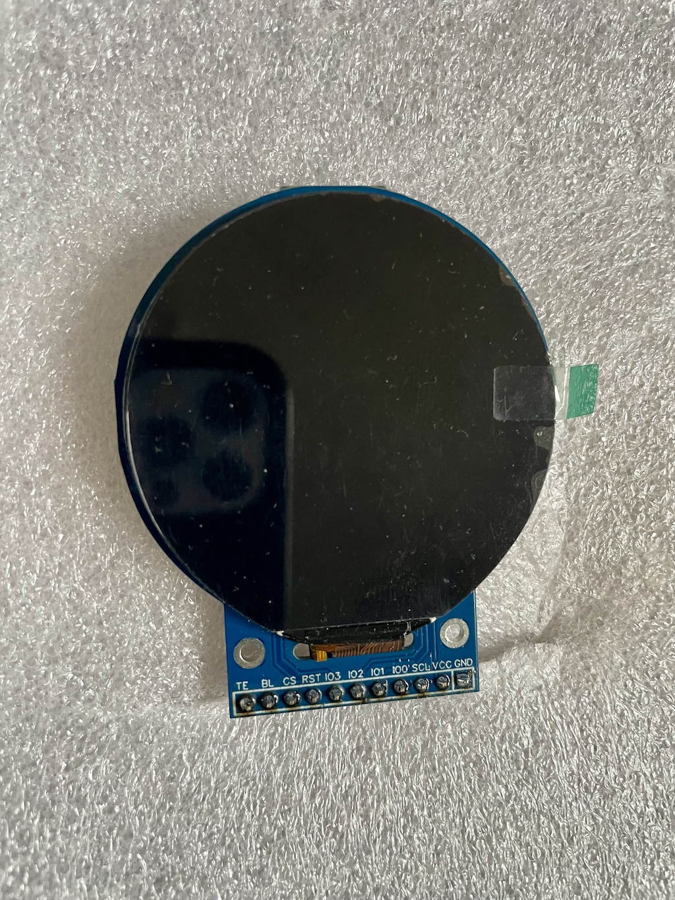
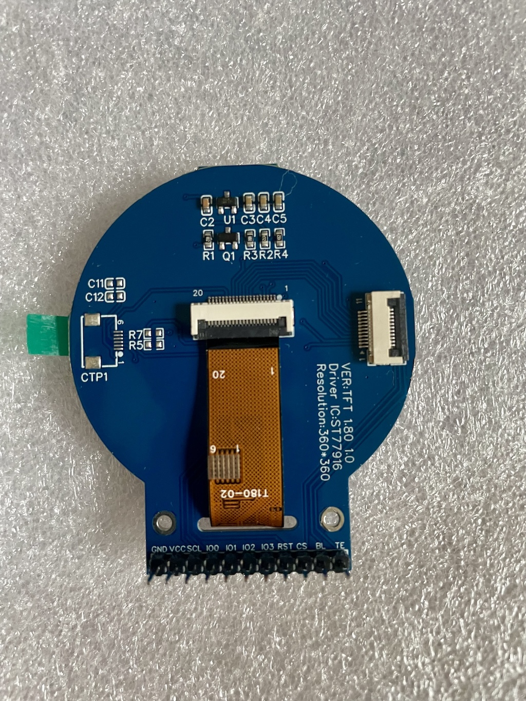

# BOE180_ST77916

Arduino library for **1.8-inch 360×360 round TFT displays** using the **BOE glass (`TI1LG1`)** and **Sitronix ST77916** controller (commonly sold by TZT with `T180-02` FPC markings).

Built on top of **Adafruit_GFX**, this library provides:
- **Hardware QSPI mode (4-bit)** on **ESP32-S3, ESP32-S2, ESP32-C3, and ESP32-C6** via native ESP-IDF `spi_master` DMA.
- **Standard 1-wire SPI mode** fallback for **ESP8266, classic ESP32, and Arduino AVR** boards without requiring a large PSRAM framebuffer.
- Vendor-specific register initialization tuned for the **BOE 1.8" `TI1LG1`** glass panel.

---

## Preview



## Screen photos





## Dependencies

- [Adafruit GFX Library](https://github.com/adafruit/Adafruit-GFX-Library)

---

## Wiring

### 1. ESP32-S3 / S2 / C3 / C6 (Hardware QSPI Mode)

| Display Pin | ESP32-S3 Example GPIO | Description |
| :--- | :--- | :--- |
| `GND` | `GND` | Ground |
| `VCC` | `3.3V` | Power supply (3.3V only) |
| `SCL` | `GPIO 12` | SPI Clock (`SCLK`) |
| `IO0` (SDA) | `GPIO 15` | Quad Data 0 (`MOSI`) |
| `IO1` | `GPIO 16` | Quad Data 1 (`MISO`) |
| `IO2` | `GPIO 17` | Quad Data 2 (`WP`) |
| `IO3` | `GPIO 18` | Quad Data 3 (`HOLD`) |
| `RST` | `GPIO 4` | Hardware Reset |
| `CS` | `GPIO 6` | Chip Select |
| `BL` | `GPIO 7` (or `3.3V`) | Backlight control |
| `TE` | *Not connected* | Tearing Effect output (optional) |

### 2. ESP8266 / Arduino / Classic ESP32 (1-Wire SPI Mode)

| Display Pin | ESP8266 (NodeMCU/D1) | Arduino Uno/Nano | Notes |
| :--- | :--- | :--- | :--- |
| `GND` | `GND` | `GND` | Ground |
| `VCC` | `3.3V` | `3.3V` | Use 3.3V logic level shifters on 5V AVR boards |
| `SCL` | `D5` (`GPIO 14`) | `D13` | Hardware SPI `SCK` |
| `IO0` (SDA) | `D7` (`GPIO 13`) | `D11` | Hardware SPI `MOSI` |
| `IO1` | *Not connected* | *Not connected* | Unused in 1-wire write mode |
| `IO2` | `3.3V` | `3.3V` | Pull high (`WP`) |
| `IO3` | `3.3V` | `3.3V` | Pull high (`HOLD`) |
| `RST` | `D1` (`GPIO 5`) | `D8` | Hardware Reset |
| `CS` | `D2` (`GPIO 4`) | `D10` | Chip Select |
| `BL` | `D3` (`GPIO 0`) or `3.3V` | `D9` or `3.3V` | Backlight control |

---

## Usage Examples

### ESP32-S3 (QSPI)

```cpp
#include <BOE180_ST77916.h>

// BOE180_ST77916(SCLK, IO0, IO1, IO2, IO3, RST, CS, BL)
BOE180_ST77916 tft(12, 15, 16, 17, 18, 4, 6, 7);

void setup() {
  tft.begin(20000000); // 20 MHz QSPI clock
  tft.fillScreen(BOE180_BLACK);

  tft.drawCircle(180, 180, 175, BOE180_WHITE);
  tft.setCursor(85, 165);
  tft.setTextColor(BOE180_GREEN);
  tft.setTextSize(3);
  tft.println("BOE 1.8 OK!");
}

void loop() {}
```

### ESP8266 / Arduino (1-Wire SPI)

```cpp
#include <BOE180_ST77916.h>

// BOE180_ST77916(RST, CS, BL)
BOE180_ST77916 tft(D1, D2, D3);

void setup() {
  tft.begin(20000000); // 20 MHz SPI clock
  tft.fillScreen(BOE180_BLUE);

  tft.drawCircle(180, 180, 175, BOE180_YELLOW);
  tft.setCursor(95, 165);
  tft.setTextColor(BOE180_WHITE);
  tft.setTextSize(3);
  tft.println("1-SPI OK!");
}

void loop() {}
```